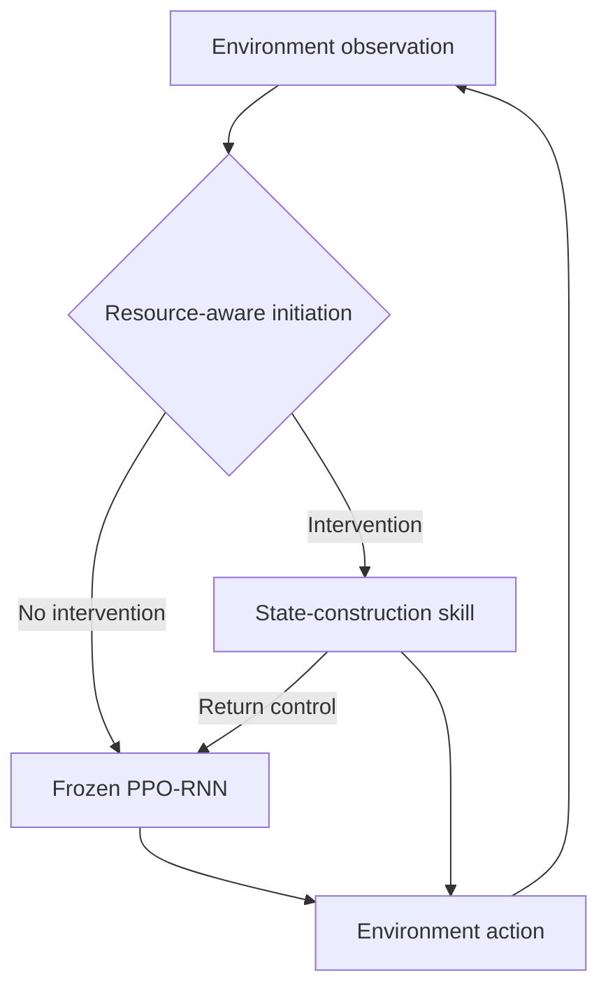

### 채민기 | Mingi Chae

**Computer Science · Hanbat National University**  
**AI Research · Reinforcement Learning · Computer Vision**

---

## 👋 About Me

안녕하세요. 국립한밭대학교에서 컴퓨터 분야를 전공하는 **채민기**입니다.

강화학습 모델의 행동과 실패 원인을 분석하고, 실험을 통해 개선 방법을 검증하는 연구에 관심이 있습니다. 현재는 Craftax 기반 강화학습 공동 연구에 참여하고 있으며, 컴퓨터 비전과 3차원 점군 처리 분야도 공부하고 있습니다.

**Research Interests**

`Reinforcement Learning` · `Skill Learning` · `Computer Vision` · `3D Point Cloud Processing`

---

## 🔬 Featured Research

### Craftax: Resource-Aware Skill Intervention for a Frozen PPO-RNN

**참여 형태:** 공동 연구 프로젝트  
**연구 저장소:** [Craftax-Resource-Aware-Skill](https://github.com/Gyeometry/Craftax-Resource-Aware-Skill)  
**협업 연구자:** [김겸](https://github.com/Gyeometry) · [문형준](https://github.com/munh36369-ship-it)

#### Research Motivation

Craftax-Classic 환경의 PPO-RNN 정책은 철 도구 제작에 필요한 재료를 확보하더라도 작업대와 화로를 이용할 수 있는 상태에 도달하지 못하는 경우가 있습니다.

본 연구는 기본 정책을 재학습하지 않고 별도의 Skill을 선택적으로 개입시켜 이러한 상태 구성의 한계를 보완합니다.

#### Proposed Method

| 단계 | 핵심 방법 |
| :-- | :-- |
| Baseline | PPO-RNN 및 Invalid Action Masking |
| Failure Analysis | 자원 수집과 제작 가능 상태 구성의 병목 분석 |
| Skill Learning | Planner 시연을 이용한 CNN-GRU Behavior Cloning |
| Resource-Aware Initiation | 제작 자원과 설비 설치 비용을 고려한 개입 조건 |
| Integration | 기본 정책 동결 및 Skill 종료 후 제어권 반환 |

#### System Architecture

[원본 연구 구조도](https://github.com/Gyeometry/Craftax-Resource-Aware-Skill/blob/main/assets/architecture.png) · [상세 모델 구조](https://github.com/Gyeometry/Craftax-Resource-Aware-Skill/blob/main/docs/ARCHITECTURE.md)

#### Experimental Results

동일한 평가 구성에서 조건당 4,096게임을 평가한 공동 연구 결과입니다.

| Evaluation | Mean Raw Return | Δ |
| :-- | --: | --: |
| PPO-RNN + Invalid Action Masking | 14.26577 | — |
| + Learned Skill | 14.39053 | +0.12476 |
| **+ Resource-Aware Initiation** | **14.49502** | **+0.22925** |

| Achievement | Baseline | Proposed |
| :-- | --: | --: |
| Iron Pickaxe | 158 | **569** |
| Iron Sword | 151 | **653** |
| Diamond | 8 | **26** |

자원 인식형 개입에서는 상태 구성 완료율이 **43.41% → 82.08%**로 높아졌습니다. 개입 대상과 시점도 달라지므로 이를 Skill 자체의 행동 능력 향상으로 단정하지 않습니다.

> 위 결과는 원본 저장소에서 보고한 팀 전체의 실험 결과이며, 개인 단독 성과를 의미하지 않습니다. 논문 게재 또는 심사 통과를 주장하지 않습니다.

[연구 수행 내역](https://github.com/Gyeometry/Craftax-Resource-Aware-Skill/blob/main/docs/PROJECT_WORK.md) · [상세 실험 결과](https://github.com/Gyeometry/Craftax-Resource-Aware-Skill/blob/main/docs/RESULTS.md)

---

## 🧰 Technical Focus

| 분야 | 기술 및 관심 주제 |
| :-- | :-- |
| Reinforcement Learning | PPO-RNN, Action Masking, Skill Learning |
| Computer Vision | Grad-CAM, CLIP, Deep Learning |
| 3D Geometry | Point Cloud, Outlier Removal, Normal Estimation |
| Development | Python, Java, Kotlin, Git |

---

## 🔗 Links

- [Personal Portfolio](https://chaemingi29-a11y.github.io/)
- [GitHub Profile](https://github.com/chaemingi29-a11y)
- [Craftax Research Repository](https://github.com/Gyeometry/Craftax-Resource-Aware-Skill)

공동 연구 코드 및 자산의 이용 조건은 원본 저장소의 [LICENSE](https://github.com/Gyeometry/Craftax-Resource-Aware-Skill/blob/main/LICENSE) 및 각 자산의 별도 라이선스를 따릅니다.

**Learn · Analyze · Experiment · Improve**

