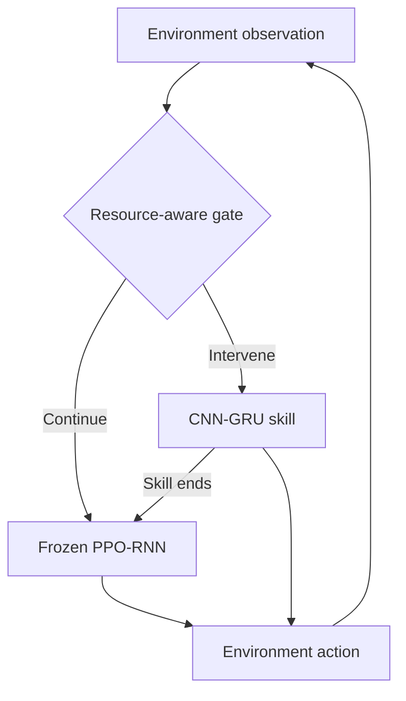

**채민기 · Hanbat National University**

---

## 👋 About Me

국립한밭대학교에서 컴퓨터 분야를 전공하고 있는 채민기입니다. 강화학습과 컴퓨터 비전을 중심으로 인공지능 모델의 동작 원리를 이해하고, 실험을 통해 성능과 한계를 검증하는 연구에 관심이 있습니다. 현재 공개된 연구 프로젝트는 Craftax 기반 강화학습 공동 연구입니다.

## Research Interests

| Research area | Focus |
| :--- | :--- |
| Reinforcement Learning | Policy Learning · Action Masking · Skill Learning |
| Computer Vision | Deep Learning · Model Interpretability |
| 3D Point Cloud | Outlier Removal · Geometric Fitting · Normal Estimation |

---

## 🔬 Featured Research — Team Project

### [Craftax — Resource-Aware Skill Intervention for a Frozen PPO-RNN](https://github.com/Gyeometry/Craftax-Resource-Aware-Skill)

**역할: 공동 연구자 (Collaborative Researcher)**  
**연구팀:** [김겸](https://github.com/Gyeometry) · [문형준](https://github.com/munh36369-ship-it) · **채민기**

Craftax-Classic 환경에서 기존 강화학습 정책이 철 도구 제작에 필요한 상태를 구성하지 못하는 문제를 분석하고, 자원 인식형 Skill 개입으로 보완하는 공동 연구입니다.

#### Research Background

필요한 자원을 확보한 정책이 제작 설비를 활용할 수 있는 상태까지 도달하지 못하는 병목에 주목합니다. 기존 정책의 파라미터를 고정하고, 필요한 시점에만 별도의 Skill을 실행하는 접근 방식입니다.

#### Research Method

| Research stage | Description |
| :--- | :--- |
| Policy baseline | PPO-RNN에 Invalid Action Masking 적용 |
| Bottleneck analysis | 자원 확보와 제작 가능 상태 구성의 실패를 분리하여 분석 |
| Skill policy | Planner의 행동 시연으로 CNN-GRU Skill 학습 |
| Selective intervention | 보유 자원과 설비 설치 비용에 따라 개입 결정 |
| Evaluation | 기본 정책의 가중치를 고정한 상태에서 비교 실험 |

#### System Architecture

Skill은 제작 가능한 상태를 준비하며, 실제 철 도구 제작 행동은 기본 정책이 선택합니다.

#### Experimental Results

조건당 4,096게임으로 평가한 팀 전체의 결과입니다.

| Evaluation condition | Mean Raw Return | Improvement |
| :--- | ---: | ---: |
| PPO-RNN + Invalid Action Masking | 14.26577 | — |
| + Learned Skill | 14.39053 | +0.12476 |
| + Resource-Aware Initiation | **14.49502** | **+0.22925** |

**Achievement comparison**

| Metric | Baseline + Masking | Proposed |
| :--- | ---: | ---: |
| Iron Pickaxe | 158 | **569** |
| Iron Sword | 151 | **653** |

자원 인식형 개입을 적용하면 Skill 시작 대비 상태 구성 완료율은 43.41%에서 82.08%로 증가했습니다. 위 수치는 팀 전체의 실험 결과이며, 개입 조건이 달라졌으므로 Skill 자체의 성능 개선으로 단정하지 않습니다.

[실험 결과 상세 보기](https://github.com/Gyeometry/Craftax-Resource-Aware-Skill/blob/main/docs/RESULTS.md)

[Research repository](https://github.com/Gyeometry/Craftax-Resource-Aware-Skill) · [System architecture](https://github.com/Gyeometry/Craftax-Resource-Aware-Skill/blob/main/docs/ARCHITECTURE.md)

공동 연구 참여 이력을 소개하며, 개인 단독 저작 또는 논문 게재 확정을 의미하지 않습니다. 원본 코드와 자산은 해당 저장소의 라이선스를 따릅니다.

#### Collaboration & Research Records

- **Participation:** 공동 연구자 (Collaborator)
- **Repository owner:** [Gyeom Kim](https://github.com/Gyeometry)
- **Research team:** Gyeom Kim · Hyeongjun Moon · Mingi Chae
- **Research records:** [Project work](https://github.com/Gyeometry/Craftax-Resource-Aware-Skill/blob/main/docs/PROJECT_WORK.md) · [Reproducibility](https://github.com/Gyeometry/Craftax-Resource-Aware-Skill/blob/main/docs/REPRODUCIBILITY.md)

---

## 🛠️ Technical Skills

**Programming**

**AI & Development**

## 📊 GitHub Activity

[View contribution history](https://github.com/chaemingi29-a11y)

---

**Learn through experiments. Improve through understanding.**

